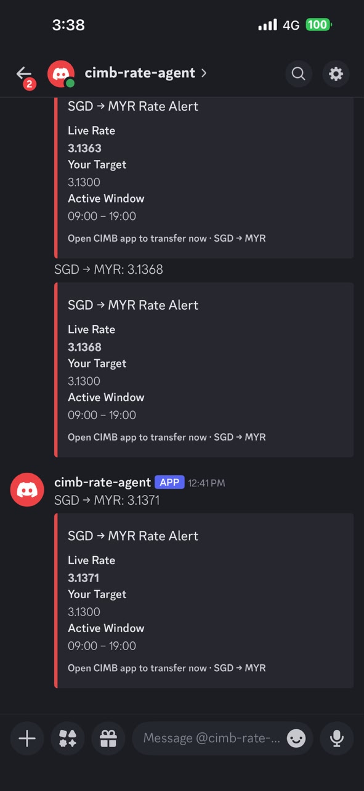
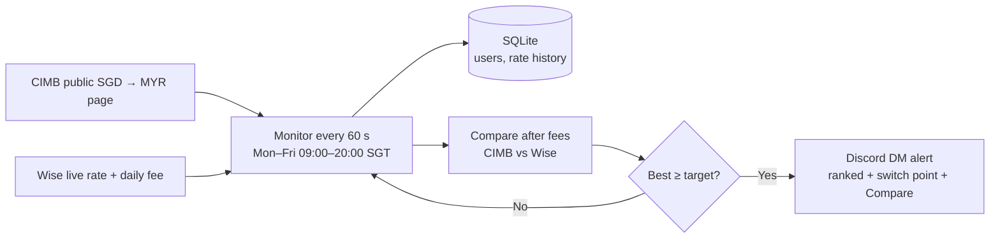

# cimb-rate-sgd-myr

A lightweight Python Discord bot that watches the SGD→MYR rate at **CIMB** and **Wise**. It works out how much MYR you would actually receive after fees, and DMs you when the best of the two reaches your target.

This repository is prepared as a public template/demo project. It does not log in to CIMB or Wise, automate any banking app, initiate transfers, store banking credentials, or perform any banking action.

## Demo

### Discord Rate Alert

<p align="center">
  
</p>

<p align="center">
  <em>Discord DM alert showing the live SGD → MYR rate (screenshot from an earlier version).</em>
</p>

The phone notification preview shows the best effective rate and who offers it:

```text
SGD → MYR: 3.1701 (CIMB) · target 3.1650
```

The alert embed:

- shows the best rate as a heading with its change since the day's first reading (▲ / ▼)
- ranks CIMB and Wise by MYR received for SGD 1,000 in an aligned table
- shows Wise's fee and the mid-market rate, with a live "updated 2 minutes ago" timestamp
- says where the cheaper provider switches, e.g. `Under SGD 1,390 → CIMB · above → Wise`

Underneath, a **Compare** dropdown (200 / 500 / 1,000 / 2,000 / 3,000 / Other…) re-ranks the same message for any amount. The embed's side bar is green at or above your target; the `/f` panel also uses amber (within 0.0010 below), grey (below) and blue (no data).

### Discord Bot Walkthrough

Demo video: [View/download MP4](docs/assets/discord-bot-demo.mp4) (earlier version)

## Features

- **Reads rates over plain HTTP, with no browser.**
  - CIMB: its public page's hidden `rateList` value.
  - Wise: its public live mid-market rate, plus its fee (cheapest bank/PayNow pay-in, refreshed daily).
- **Compares what you actually receive.** CIMB has no fee. Wise charges a fixed part plus a percentage, so the winner depends on the amount.
- **Alerts on the best effective rate after fees.** It re-alerts only when the rate climbs at least 0.0010 above your last alert.
- **Fixed schedule:** Mon–Fri, 09:00–20:00 Singapore time. Nothing is fetched outside it.
- **One `/f` panel** that updates in place: live rates, switch point, target, alerts on/off, compare any amount.
- **One small SQLite file** for users and rate history.
- **Errors-only logging.** Runs as a systemd service on a small VM, using ~30–70 MB RAM.

## Architecture



Runtime components:

| File | Role |
|---|---|
| `agent.py` | Entrypoint. Starts the Discord bot and the monitor. `python agent.py --check` fetches rates once and exits. |
| `monitor.py` | Schedule-aware 60 s poll loop. Stores rates and evaluates users. |
| `providers/` | CIMB and Wise HTTP fetchers and parsers. |
| `compare.py` | MYR received per provider, ranking, switch point, amount parsing. |
| `alerts.py` | Alert / reset / none decision per user. |
| `embeds.py`, `ui.py`, `notifier.py`, `bot.py` | Discord embeds, dropdown/buttons/modals, alert DMs, slash commands. |
| `db.py` | SQLite storage for users, rate history and the Wise fee. |
| `settings.py` | All tunable constants (schedule, intervals, fee defaults, presets). |
| `cimb-agent.service` | systemd unit for the VM. |

## Discord Commands (DM only)

| Command | Purpose |
| --- | --- |
| `/reg name` | Register with the default target (3.1000). |
| `/t rate` | Set your target effective rate (after fees), e.g. `3.1650`. |
| `/a on\|off` | Turn alerts on or off. |
| `/f` | Open the panel: live rates, switch point, target, alerts toggle, compare any amount. |
| `/help` | Show what each command does. |

The `/f` panel is built for phones. Every button edits the same message instead of posting new ones.

## Deployment Overview

The intended deployment is a small Linux VM (Debian 13, Python 3.13) running the agent with systemd:

1. Install Python dependencies from `requirements.txt` into `/opt/cimb-rate-sgd-myr/.venv`.
2. Create `.env` with the Discord token (see below).
3. Install `cimb-agent.service` under systemd.
4. Use GitHub Actions Secrets for SSH deployment credentials.
5. Push to `main`: GitHub Actions runs the tests (Python 3.13), and only if they pass deploys the code and restarts the service.

The deployment workflow does not need banking credentials. It deploys code, installs dependencies, copies the service file, reloads systemd and restarts the agent.

See [docs/deployment.md](docs/deployment.md) for the VM and GitHub Actions guide.

## Security Notes

This project is notification-only:

- It does not log in to CIMB or Wise.
- It does not automate any banking app.
- It does not perform bank transfers.
- It does not store bank account numbers, passwords, OTPs, or session cookies.
- It only reads public rate pages/endpoints, sending nothing but the currency pair and an amount.
- It sends alerts through Discord DMs.

Never commit:

- `.env`
- `data/` (SQLite database with Discord IDs)
- Discord bot tokens
- VM IP addresses
- SSH keys
- private key files such as `*.key` or `*.pem`
- raw screenshots or recordings that contain Discord IDs, usernames, server names, tokens, VM details, or personal data

Sanitize demo screenshots before publishing. Use `docs/assets/raw/` only as a local staging folder; it is gitignored.

## Template Usage

To adapt this repository for your own deployment:

1. Fork the repository.
2. Create your own Discord application and bot token.
3. Copy `.env.example` to `.env` and fill in the token.
4. Install dependencies.
5. Register through Discord with `/reg`.
6. Deploy to your own VM and configure GitHub Actions Secrets for that VM.
7. Replace demo assets with your own sanitized screenshots before sharing publicly.

## Requirements

- Python 3.13 (what the VM and CI use; 3.10+ works)
- Git
- Discord bot token
- Dependencies listed in `requirements.txt` (`discord.py`, `python-dotenv`)

## Local Setup

```bash
git clone https://github.com/yourusername/cimb-rate-sgd-myr.git
cd cimb-rate-sgd-myr
python -m venv .venv
source .venv/bin/activate
pip install -r requirements.txt -r requirements-dev.txt
cp .env.example .env
```

Edit `.env`. It only holds the bot token; everything else lives in `settings.py`:

```env
DISCORD_BOT_TOKEN=your_bot_token_here
```

Check the rate sources, then run the agent and the tests:

```bash
python agent.py --check   # prints e.g. cimb=3.1768
python agent.py
pytest -q
```

## User Settings

Users register with `/reg` and manage settings with `/f`, `/t` and `/a`. Settings and rate history are stored in `data/rates.db` (SQLite, gitignored).

## File Structure

```text
cimb-rate-sgd-myr/
|-- agent.py
|-- monitor.py
|-- alerts.py
|-- compare.py
|-- db.py
|-- settings.py
|-- models.py
|-- schedule.py
|-- bot.py
|-- ui.py
|-- embeds.py
|-- notifier.py
|-- providers/
|   |-- cimb.py
|   `-- wise.py
|-- tests/
|-- cimb-agent.service
|-- requirements.txt
|-- requirements-dev.txt
|-- .env.example
|-- .github/workflows/deploy.yml
|-- docs/
|   |-- deployment.md
|   `-- assets/
`-- README.md
```

## What Is Not Implemented

- Rate prediction or forecasting
- Providers other than CIMB and Wise
- Web dashboard
- Bank login automation
- Banking app automation
- Bank transfers
- Telegram, email, or SMS notifications
